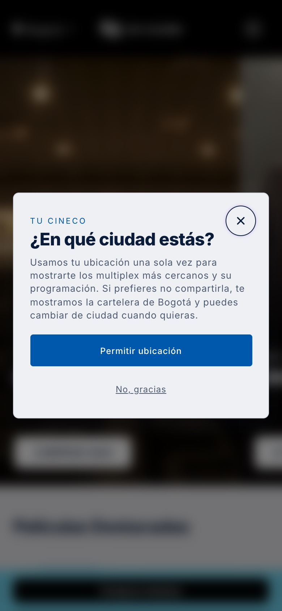
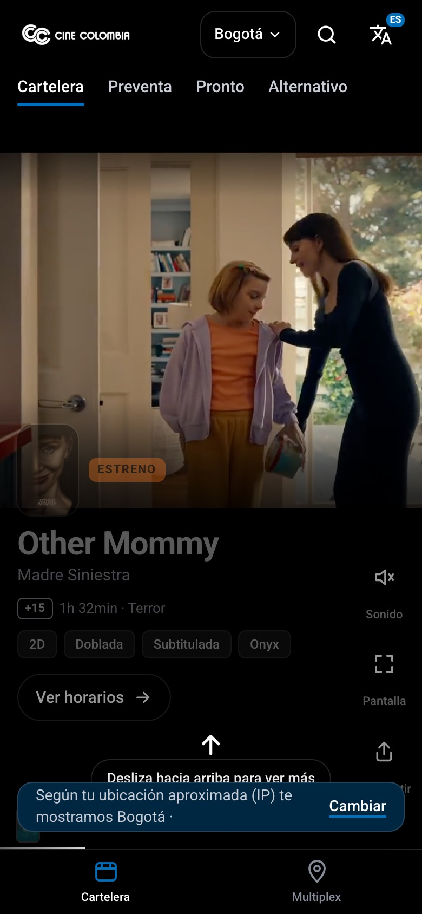
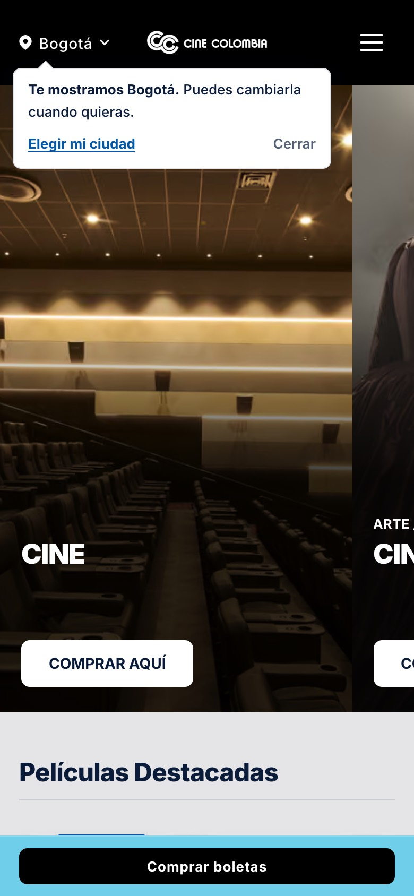
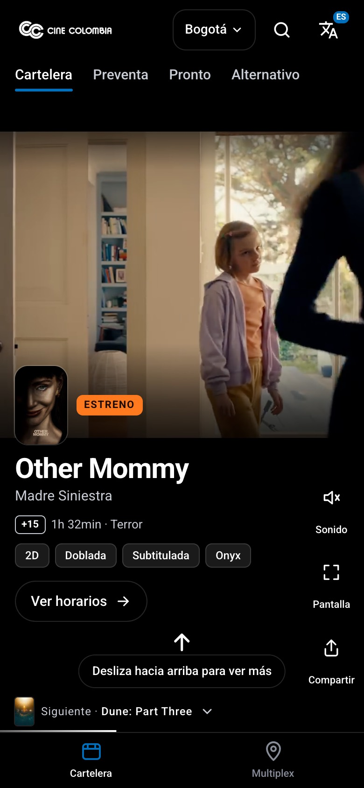
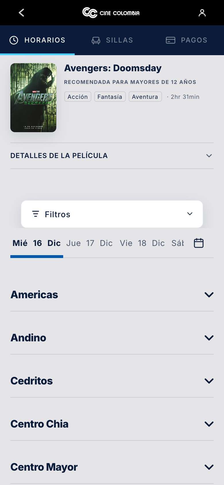
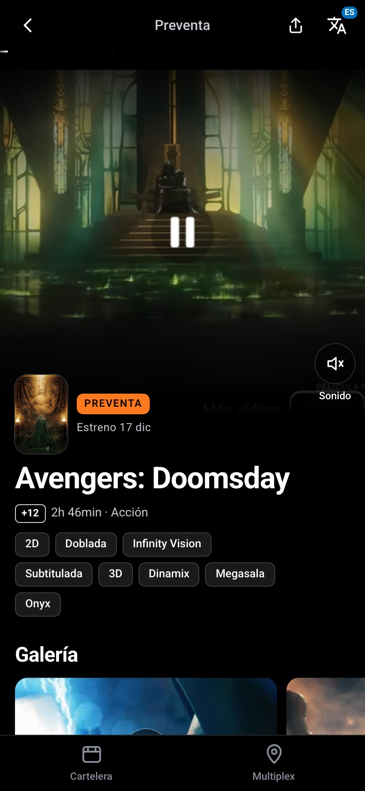
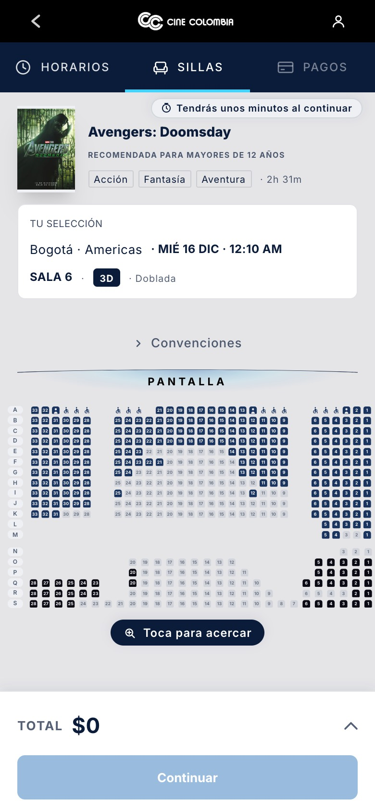
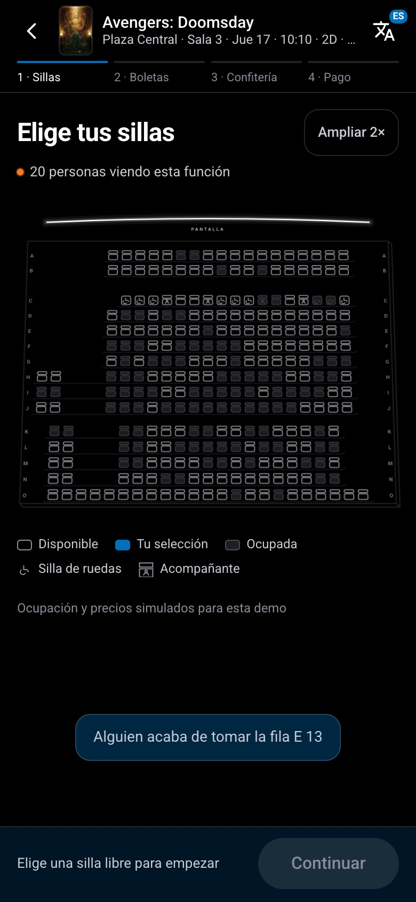

# Cine Colombia reboot

A front-end exercise, built over a weekend with AI coding agents (Claude Code), to show how good the mobile experience of a large cinema ticketing site can be. It rebuilds the phone experience of [cinecolombia.com](https://www.cinecolombia.com/), the biggest cinema chain in Colombia: a vertical trailer feed, movie pages with showtimes, and a seat-to-payment ticket flow.

Live demo: https://ortegoncarlos.github.io/cinecolombia-reboot/

This is an unofficial demo, not affiliated with Cine Colombia. It has no backend and no real purchases. Movie data, images and trademarks belong to their owners.

## Before and after

iPhone view (390 x 844, 2x), captured on 23 November 2026 as a first-time visitor. Original on the left, reboot on the right.

<table>
  <tr><th>cinecolombia.com</th><th>Reboot</th></tr>
  <tr>
    <td></td>
    <td></td>
  </tr>
  <tr><td colspan="2" align="center">First screen on load</td></tr>
  <tr>
    <td></td>
    <td></td>
  </tr>
  <tr><td colspan="2" align="center">Home after dismissing what blocks it</td></tr>
  <tr>
    <td></td>
    <td></td>
  </tr>
  <tr><td colspan="2" align="center">Movie detail (Avengers: Doomsday)</td></tr>
  <tr>
    <td></td>
    <td></td>
  </tr>
  <tr><td colspan="2" align="center">Start of the ticket flow (seat map, no login needed on either site)</td></tr>
</table>

## Numbers

### Load times in a real browser

Median of 5 cold loads per URL.

| Metric | Original home | Reboot home | Original movie page | Reboot movie page |
|---|---|---|---|---|
| Time to first byte | 531 ms | 89 ms | 457 ms | 45 ms |
| DOMContentLoaded | 827 ms | 349 ms | 592 ms | 349 ms |
| Load event | 1,720 ms | 426 ms | 1,409 ms | 1,082 ms |
| First Contentful Paint | 852 ms | 384 ms | 768 ms | 384 ms |
| Largest Contentful Paint | 928 ms | 688 ms | 1,492 ms | 924 ms |
| Cumulative Layout Shift | 0.122 | 0.007 | 0.563 | 0 |
| Long-task blocking time after FCP | 254 ms | 11 ms | 41 ms | 84 ms |
| Requests | 48 | 23 | 35 | 22 |
| Transferred | 1.76 MB | 7.28 MB | 1.14 MB | 334 KB |

Measured on 23 November 2026 with Google Chrome (headless) driven by playwright-core 1.57.0 over the Chrome DevTools Protocol. iPhone emulation: 390 x 844 viewport, device scale factor 2, touch, mobile Safari user agent. Each run used a fresh browser context with the cache disabled. No network or CPU throttling was applied; the runs went over a home connection in Bogotá, so a mid-range phone on mobile data would see slower absolute times. Requests and bytes are counted until 5 seconds after the load event. Blocking time is the sum of long tasks over 50 ms after First Contentful Paint as seen from the page, which is close to Lighthouse's Total Blocking Time but not the same metric. The pages measured were `https://www.cinecolombia.com/` (a first visit is not redirected), `https://www.cinecolombia.com/peliculas/avengers-doomsday`, the reboot's `index.html` and `pelicula.html?id=HO00000878`.

### Lighthouse (PageSpeed Insights, mobile)

One PageSpeed Insights run per URL on 23 November 2026, Mobile tab. PSI states the setup as an emulated Moto G Power with Lighthouse 13.6.0 and slow 4G throttling.

<table>
  <tr><th>cinecolombia.com home</th><th>Reboot home</th></tr>
  <tr>
    <td></td>
    <td></td>
  </tr>
</table>

| | Original home | Reboot home | Original movie page | Reboot movie page |
|---|---|---|---|---|
| Performance | 82 | 91 | 87 | 51 |
| Accessibility | 96 | 96 | 100 | 100 |
| Best Practices | 96 | 100 | 96 | 96 |
| SEO | 100 | 100 | 100 | 100 |
| First Contentful Paint | 1.2 s | 0.8 s | 2.9 s | 6.6 s |
| Largest Contentful Paint | 3.2 s | 3.6 s | 2.9 s | 9.7 s |
| Total Blocking Time | 80 ms | 10 ms | 20 ms | 360 ms |
| Cumulative Layout Shift | 0.125 | 0.009 | 0 | 0 |
| Speed Index | 6.6 s | 0.9 s | 4.7 s | 6.6 s |
| Report | [PSI](https://pagespeed.web.dev/analysis/https-www-cinecolombia-com/8tt7eqr1c9?form_factor=mobile) | [PSI](https://pagespeed.web.dev/analysis/https-ortegoncarlos-github-io-cinecolombia-reboot/7caw1mpqbm?form_factor=mobile) | [PSI](https://pagespeed.web.dev/analysis/https-www-cinecolombia-com-peliculas-avengers-doomsday/1p4h8jn6uc?form_factor=mobile) | [PSI](https://pagespeed.web.dev/analysis/https-ortegoncarlos-github-io-cinecolombia-reboot-pelicula-html/90tkrg4psr?form_factor=mobile) |

PSI also shows Chrome real-user data (the 28-day CrUX field data) for the two cinecolombia.com URLs, and both fail Core Web Vitals. The home page has a field LCP of 3.9 s, INP of 399 ms and CLS of 0.38. The movie page has LCP 1.8 s, INP 183 ms and CLS 0.21. The reboot has too little traffic for field data.

Raw runs, settings and the scripts that produced them are in [`docs/readme/measurements/`](docs/readme/measurements/).

The original wins in several places. Its home page transfers fewer bytes, because the reboot's first card autoplays a self-hosted trailer and preloads the next one: in a separate breakdown run, 6.92 MB of the reboot home's bytes were video, and everything else (HTML, CSS, JS, fonts, images, JSON) came to about 352 KB. Lighthouse gives the original home a slightly faster LCP (3.2 s against 3.6 s). On the movie page the original scores 87 for performance against the reboot's 51, with a 2.9 s LCP against 9.7 s under Lighthouse's throttling, and it also had less main-thread blocking time in the unthrottled runs. The reboot's movie page is the clearest next thing to fix.

## What was wrong and what changed

These points come from the screenshots and measurements above and from the audit notes in [`docs/auditoria-ui-ux.md`](docs/auditoria-ui-ux.md).

A first-time visitor to cinecolombia.com gets a modal asking which city they are in, over a blurred page, before seeing any movie, and Lighthouse's final screenshot of the movie page shows the same modal when that page is opened directly. After "No, gracias", a second popover about the chosen city opens under the header. The reboot picks the nearest city from an approximate IP lookup, starts the trailer feed, and names the city it picked in a small toast with a Cambiar link that leaves the page usable.

The original home loads 21 scripts totaling about 920 KB on the wire (in the breakdown run). The reboot home loads 5 scripts and about 59 KB: Alpine.js from a CDN, the session recorder, and hand-written JavaScript with no build step.

Layout shift is the largest gap in what real visitors get. Chrome's field data for cinecolombia.com reports a CLS of 0.38 on the home page and 0.21 on the movie page, against the 0.1 that Google counts as good. In the unthrottled runs above, the original movie page had a median CLS of 0.563 and the home 0.122, while the reboot measured 0 and 0.007. Lighthouse's single throttled run caught less of it on the original (0.125 on the home page, 0 on the movie page).

On the original movie page, showtimes sit behind one collapsed accordion per multiplex (19 for Bogotá), under a filter panel and a date strip, so seeing any time means picking a multiplex first. The reboot lists the times under each multiplex, sorts multiplexes by distance, and marks the next showing.

The reboot's ticket flow has four labeled steps (Sillas, Boletas, Confitería, Pago) with a progress bar, a 2x zoom for the seat map, and a warning 60 seconds before the seat hold expires. Its own audit is in [`docs/auditoria-ui-ux.md`](docs/auditoria-ui-ux.md), including Lighthouse accessibility at 100 on all four pages in local runs at the time of the audit. PageSpeed Insights gave the live home page 96 on 23 November.

## How it is built

The exercise is a static front end by design. There is no framework and no backend: plain HTML pages, hand-written CSS, Alpine.js 3.14 from cdnjs, and JSON files in `data/`. Any static host can serve it; this one runs on GitHub Pages.

The film, cinema and showtime data is a one-time snapshot of Cine Colombia's public web API (`digital-api.cinecolombia.com/ocapi/v1`), taken on 11 October 2026 with the guest token embedded in the cinecolombia.com home page: the full film catalogue, film availability, the 50 sites, and seven days of showtimes for every city. City and cinema names come from the home page's own `cinemaGroups` list. A throwaway Node script turned the raw responses into one films file, one cities file, and one showtimes file per city per day. Posters, backdrops and trailer data come from TMDB; the few films without a TMDB match use the distributor poster from the Moviexchange CDN, stored in `media/`. Showtimes are only accurate for the week of 11 to 17 October 2026, so the demo clock is frozen at 11 October 2026 22:00 (Bogotá). Set `DEMO_NOW` in `assets/app.js` to `null` for live time.

Preventa films that open after 17 October have no real showtimes yet, so their release week is simulated from that week's schedule: one file per film and city under `data/showtimes/preventa/`, cloned from each city's busiest cartelera film (same multiplex, times and rooms, so seat maps work), with show ids `pv-{filmId}-{n}`. The Confitería step reads `data/food.json`, with the menu, prices (as of 12 October 2026) and resized product photos from Cine Colombia's public food page. Seat occupancy and prices in the ticket flow are simulated.

### The trailer feed and iOS Safari

The feed was the hard part. The first version embedded a YouTube or TikTok player per card. Measured on an iPhone over USB with Web Inspector, muted autoplay worked, but sound did not carry from one card to the next. WebKit only accepts unmuting a cross-origin iframe while a user gesture is being handled. The gesture reaches the iframe through `postMessage` only when the message is sent synchronously inside the tap handler, and the scroll or `touchend` of a swipe does not count as a gesture. Every new per-card player started locked again.

The feed now uses two native `<video playsinline muted loop>` elements that move with the cards. One plays the active card; the other preloads the next clip in the swipe direction, paused on its first frame. When the user taps Sonido, the active video is unmuted inside the tap, and the preload gets a silent `play()` and `pause()` in the same tap. WebKit then treats both elements as unlocked for the session, so every following card starts with sound without another gesture. A fresh page load always starts muted, because iOS rejects autoplay with audio, even when the saved preference is sound on. Two smaller findings from the device: `volume` is read-only on iPhone (only `muted` works), and a rejected `play()` retries muted before a play button appears. The full design and the iPhone measurements are in [`docs/auditoria-player.md`](docs/auditoria-player.md).

### Languages

The UI speaks Spanish (default), English, French, Portuguese (Brazil) and Chinese (Simplified). The language comes from `?lang=xx` (also saved), then the choice saved from the language menu (`localStorage cineco.lang`), then `navigator.languages`, then Spanish. Strings live in flat dictionaries `data/i18n/{es,en,fr,pt,zh}.json`; markup uses `$t('key')` (Alpine) or `data-i18n="key"` / `data-i18n-a="attr:key"`, and JS uses `t('key', { n })` with `{var}` interpolation and `key_one` / `key_other` plurals. Dates, prices (COP) and distances are formatted with `Intl` for the active locale. Movie data is not translated. To add a language, copy `es.json` to `xx.json`, translate the values, and add `xx` to `LOCALE` and `LANGS` in `assets/app.js`.

### Promos

Promo cards in the Cartelera feed come from `data/promos.json`: `after: n` places the card after the n-th film, and `clip` (and `vertical`) point to the self-hosted video in `media/trailers/` the same way a film's does.

### Privacy

On the first visit the browser asks get.geojs.io for an approximate location based on the IP address, only to pick the nearest city and sort multiplexes by distance. City, location and sound choices are stored in the browser's localStorage.

The live demo records sessions with [Smartlook](https://www.smartlook.com/) so the feed can be reviewed (`SMARTLOOK_KEY` and region in `assets/app.js`). The approximate IP-based city and coordinates are attached to the session; the exact GPS position used to sort multiplexes is never sent. The feed sends custom events: `card_view` on every card activation `{ id, title, index, via: swipe|wheel|key|tap|initial, muted }`, `cta_click` on Ver horarios / Ver detalles `{ id, index }`, `sound_on` / `sound_off`, and for the first-visit swipe hint, `swipe_hint_shown` and `first_swipe` `{ hint, desk }` (reset the first visit with `?fresh=1`).

## How AI was used

Claude Code agents did the hands-on work while I directed, reviewed, and tested on my own iPhone. 19 of the 24 commits in this repo carry a Claude co-author line. The working rules live in a project skill file: one agent per cluster of files so agents do not overwrite each other's work, the smallest change at the place where a problem starts, no new dependencies, and data kept as committed JSON.

Device bugs went through a measured loop. The working tree is served on the local network, the iPhone opens it with `?debug=1` for an on-screen log, and an agent reads the page over USB through `ios_webkit_debug_proxy` and Web Inspector while I reproduce the bug by hand. The findings from that loop, including the iframe sound behavior that led to dropping the YouTube and TikTok embeds, are in [`docs/auditoria-player.md`](docs/auditoria-player.md). The UI/UX audit in [`docs/auditoria-ui-ux.md`](docs/auditoria-ui-ux.md) lists each finding with its severity and status, a heuristic scorecard before and after the fixes, and Lighthouse results per page.

## Run locally

```sh
npx serve .
```

Any static server works (`python3 -m http.server`). Opening the files with `file://` does not work because the pages `fetch()` the JSON in `data/`.

## Tests

```sh
npm i && npm test
```

`tests/i18n.mjs` checks that the dictionaries are complete, that every key used in the HTML and JS exists, and that all four pages render in all five languages. `tests/feed-player.mjs` runs 13 cases of the feed player (muted start of the first card, preload in the swipe direction and role swap, Sonido unlocking both elements, saved preference, cards without a clip, rejected `play()` and the play button, hidden tab, dimming, full screen, desktop) with `HTMLMediaElement` stubbed in Chrome under iPhone 13 emulation, without network. `ONLY=4 npm test` runs a single case. The tests need Google Chrome installed; the site itself has no dependencies.

## Project layout

```
index.html          trailer feed (Cartelera, Preventa, Pronto, Alternativo)
pelicula.html       movie detail and showtimes, ?id=HO00000666
multiplex.html      multiplex list, or one multiplex with ?id=6871
boleta.html         seats, tickets, Confitería, payment, ?show=<id>
assets/             app.js, app.css (shared), per-page CSS, boleta.js
data/               films, cities, showtimes, seats, food, promos, i18n JSON
media/              self-hosted trailer clips, posters, food photos
scripts/            make-clips.sh, fetch-trailers.sh, share-pages.mjs
tests/              i18n.mjs, feed-player.mjs
docs/               audits, README screenshots and measurements
```

## Publishing

GitHub Actions (`.github/workflows/pages.yml`) publishes the site to GitHub Pages on every push to `main`. The deploy also generates static share pages in `s/{id}/` (`scripts/share-pages.mjs`) with Open Graph tags per movie, so WhatsApp and Facebook show title, synopsis and image. If the site moves to another domain, update `SITE_URL` in `assets/app.js` and the `SITE_URL` variable in the workflow.

## Credits

Film metadata, posters and backdrops come from [TMDB](https://www.themoviedb.org/). This product uses the TMDB API but is not endorsed or certified by TMDB. Trailers on the movie page are YouTube embeds (privacy-enhanced `youtube-nocookie.com`). Logo and brand belong to Cine Colombia. Typeface: Roboto (Google Fonts).
